# Stagebook

Stagebook is an offline workspace for blocking and rehearsing musicals, plays, and other staged performances. Plan entrances and crosses against song time, cue lights from a lyric, and give the cast one portable copy to review between rehearsals.

**[Download Stagebook v9.7.1](https://github.com/YiChenLu0119-prog/stagebook/releases/download/v9.7.1/Stagebook-v9.7.1-offline.zip)** · [Quick start](docs/quick-start.md) · [Releases](https://github.com/YiChenLu0119-prog/stagebook/releases) · [Roadmap](docs/ROADMAP.md)

Extract the ZIP and open **Stagebook.html** in a desktop browser. Keep the **演出资料** folder beside it. The app works offline without an account or installation. Switch between English, Simplified Chinese, and Traditional Chinese in the top bar.

## Blocking and song timeline

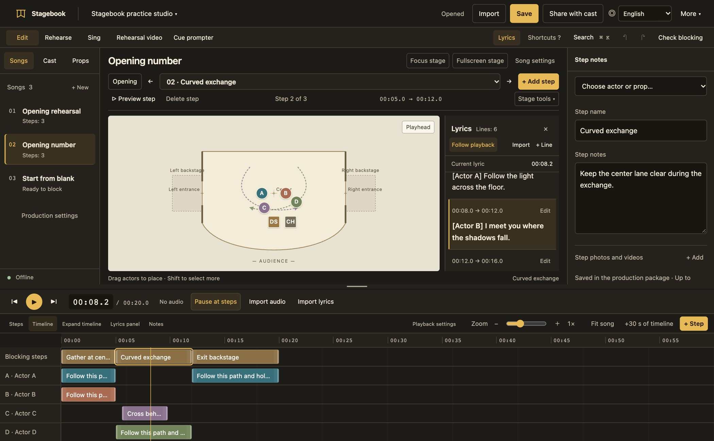

- **Stage and lyrics.** Drag actors to their destinations, shape their paths, and scrub to see the positions and lyric at any moment.
- **Blocking steps and actor tracks.** Add a step at the playhead. Drag a performer’s clip or its edges to change when they start and how long they move.
- **Step notes.** Keep directions beside the selected step, such as who clears a lane or where an actor leaves a prop.

For a musical number, this lets a director see whether a cross finishes before the next entrance and adjust the timing while keeping the lyric in view. Songs can also be blocked without audio or lyrics.

## Lighting cue prompter

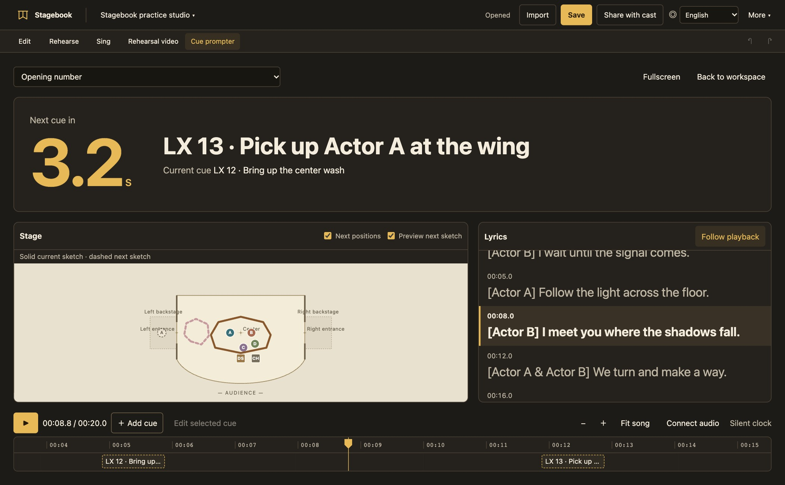

The countdown and next lighting instruction sit at the top. The stage on the left shows a solid sketch for the current cue and an optional dashed preview of the next. The active lyric is on the right, and the lighting timeline runs along the bottom.

Drag the playhead to the right moment and choose **Add cue**. Drag a marker to retime it, or use **Snap to lyrics** so it follows the start of a line. Select a marker to draw its own stage sketch. During playback, the next sketch becomes solid when the cue fires. Use fullscreen at the lighting desk.

## Actor rehearsal

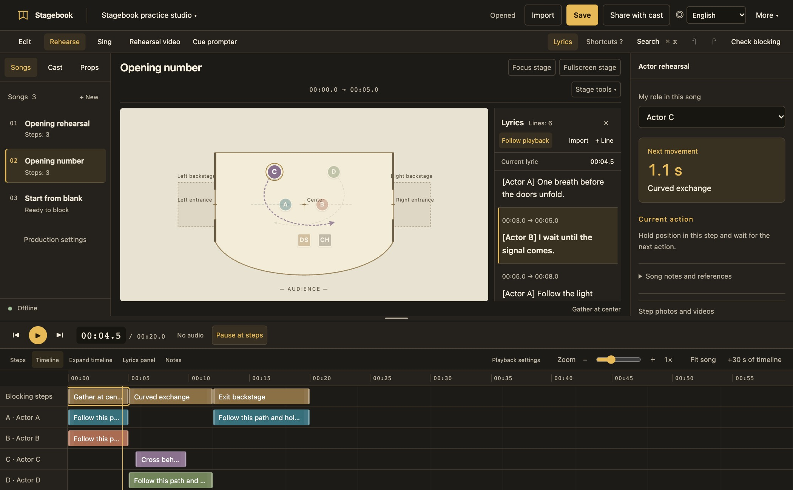

Choose your role to see your current action and how long until your next move. Follow the same stage, lyrics, and notes the director used to block the number.

## Singing practice

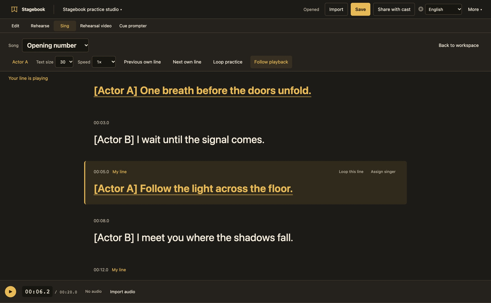

Select your roles to highlight your parts while keeping the other voices visible. Jump to your next entrance, repeat a passage with a pickup, or slow down playback.

## Full-song rehearsal video

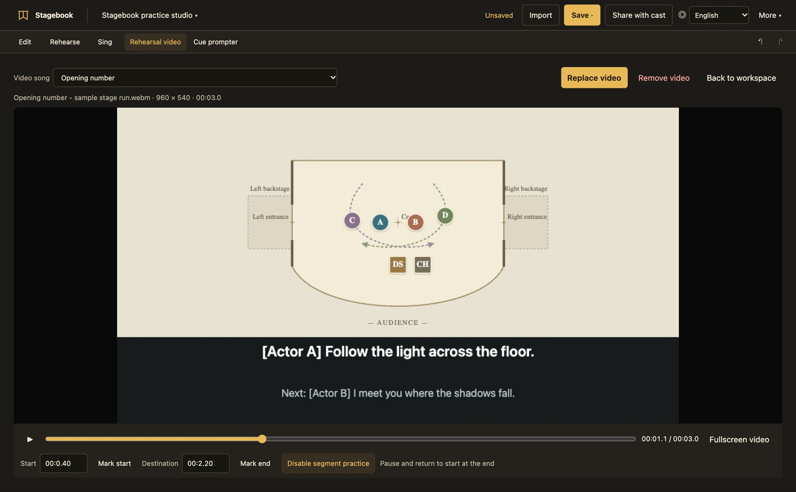

Attach a recording to a song and scrub it or open it fullscreen. Mark a start and end for a difficult section. At the end, the player pauses and returns to the start for another pass. The screenshot uses a sample stage run recorded from Stagebook.

## More tools, shown in the app

<strong>Step photos and videos</strong>

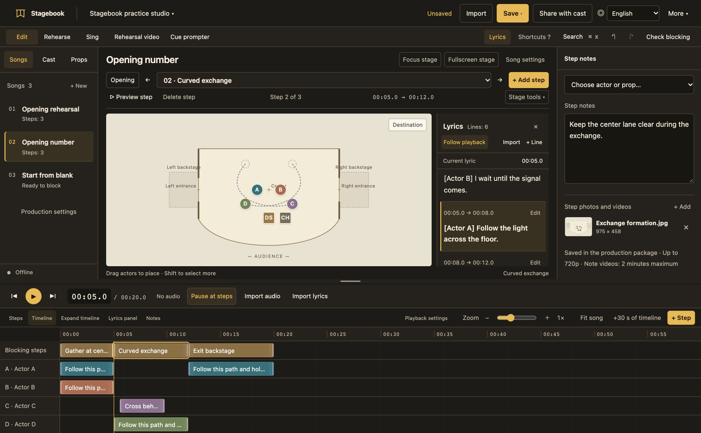

Keep a formation photo or short reference clip beside the exact step it belongs to. The attachment travels with the production package.

<strong>Export a stage walkthrough</strong>

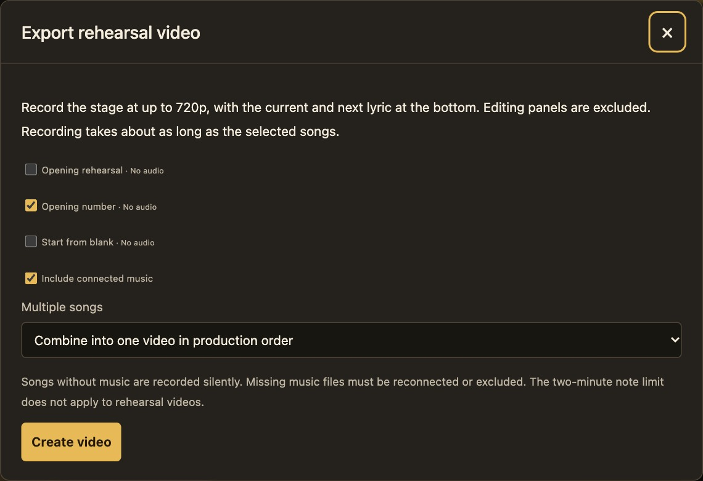

Record the schematic stage with the current and upcoming lyric along the bottom. Include connected music and export one song, separate songs, or a combined run.

<strong>Rehearsal notes and printable handoffs</strong>

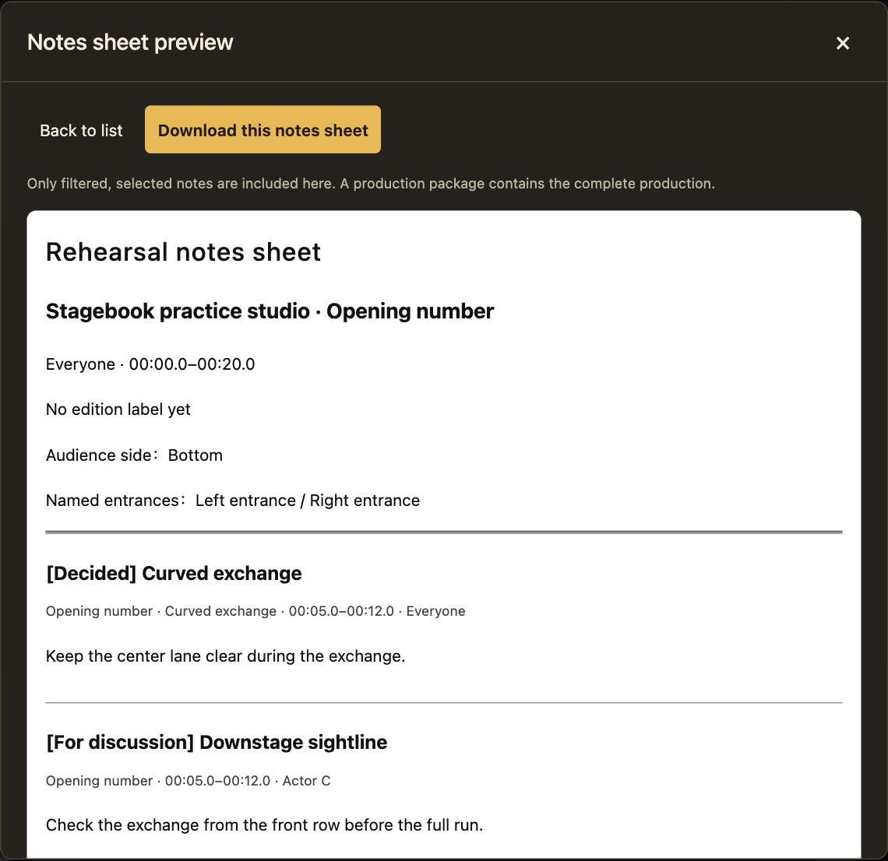

Collect existing notes, filter them by role or time, and export a printable sheet for the next rehearsal.

<strong>Version history</strong>

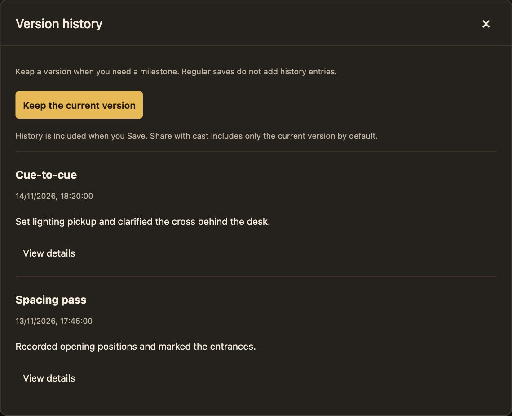

Keep named snapshots of rehearsal milestones. Reopen, export, or restore a saved version as the blocking changes.

<strong>Share with cast</strong>

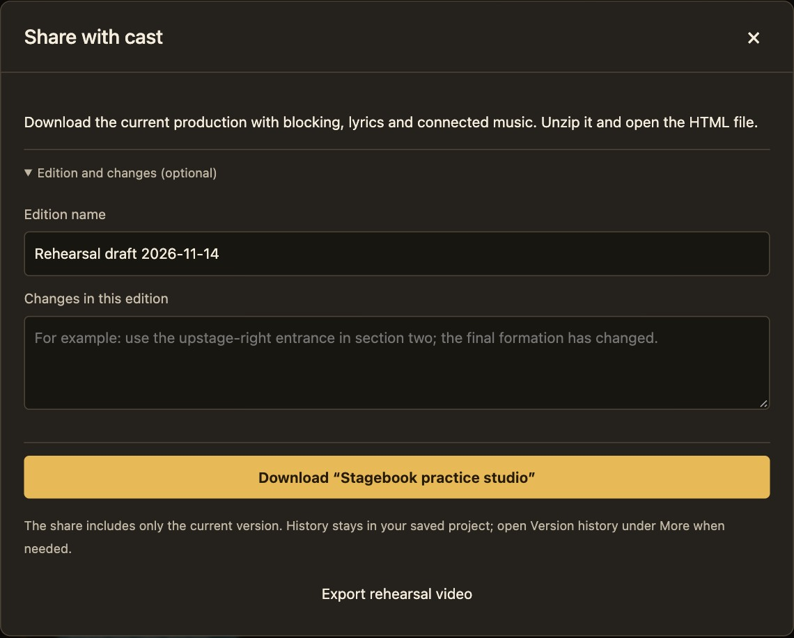

Send the cast a portable package with blocking, lyrics, notes, and connected media. Add an edition label and a short change summary when the cast needs to tell versions apart.

<strong>Import a production</strong>

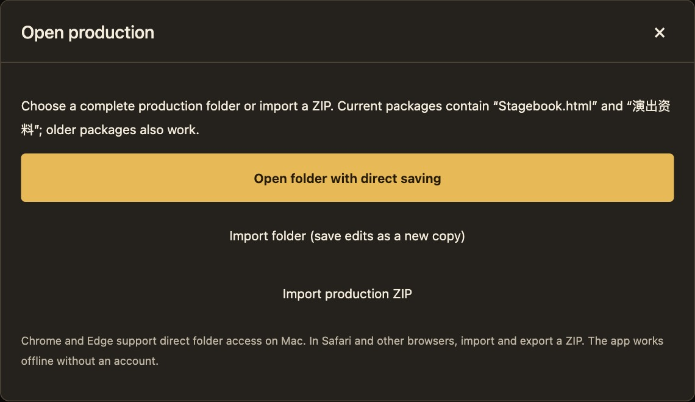

Reopen a saved ZIP or folder. When upgrading, save your current work, open the new **Stagebook.html**, then import your saved production.

<strong>Appearance</strong>

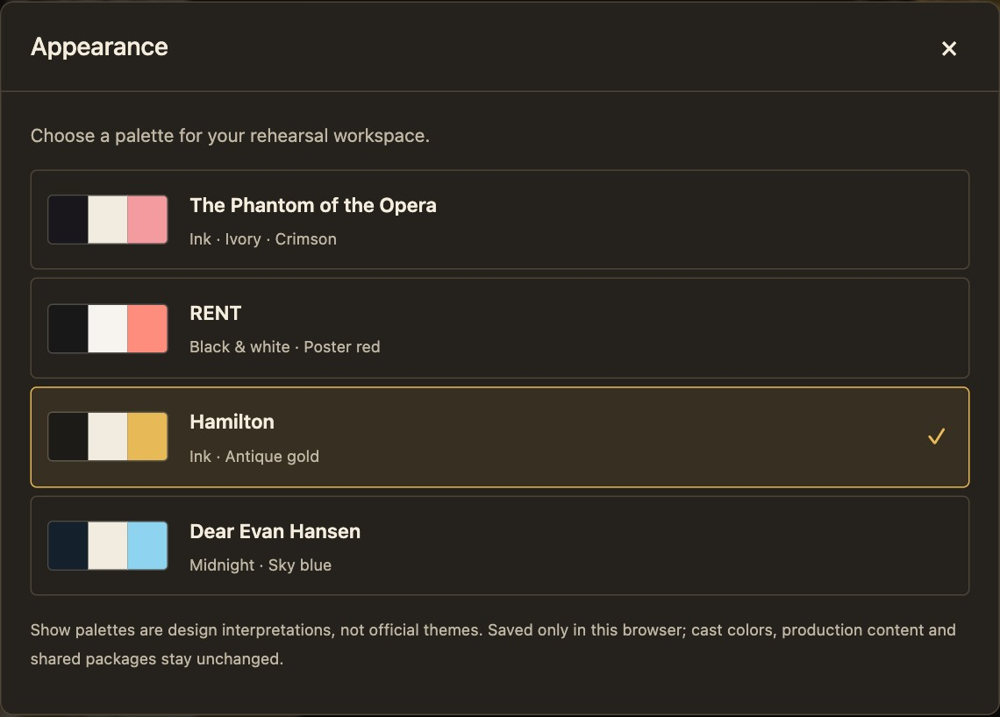

Choose one of four musical-theatre-inspired palettes under **More → Appearance**. Use **Fullscreen stage** in the editor when you need a larger stage view.

All screenshots were captured in the released Stagebook v9.7.1 using a generic rehearsal project, original sample lyrics, and locally made sample media.

## Prepare a production with an external AI assistant

Give your assistant a saved package and the [AI import guide](AI-GUIDE.md). It can turn measured stage dimensions into boundaries and entrances, organize a cast or script breakdown, prepare lyric timestamps from supplied audio when it has suitable tools, or draft actor paths. Ask for a complete import-ready ZIP, then review the timing and movement in Stagebook. AI preparation happens outside the offline editor.

## Ongoing development

Future work will explore more comfortable editing, clearer cast handoffs, cue readability at the lighting desk, browser compatibility, and accessibility. A desktop edition remains under exploration. Follow the [roadmap](docs/ROADMAP.md) or open an [issue](https://github.com/YiChenLu0119-prog/stagebook/issues) with a rehearsal task and where it got difficult.

## Build and license

Run `python3 build.py` and open `dist/Stagebook.html`. Run `node scripts/check.cjs` for the automated checks. See [development notes](docs/development.md), [contributing](CONTRIBUTING.md), and [data and privacy](docs/data-and-privacy.md).

Stagebook is licensed under [GPL-3.0-only](LICENSE). Imported music, lyrics, and production material retain their own permissions.
