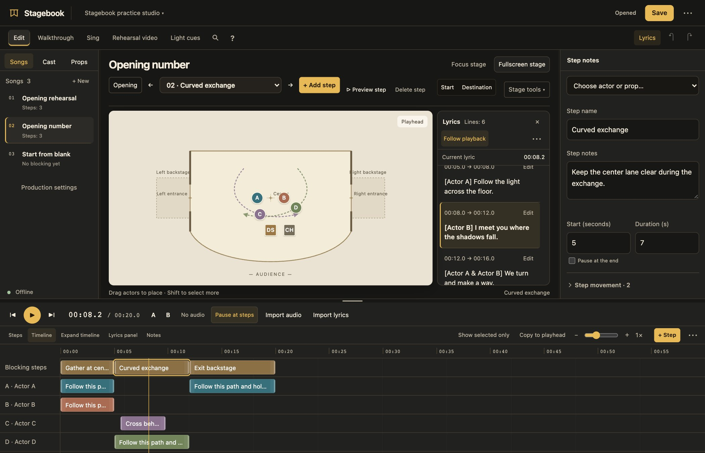
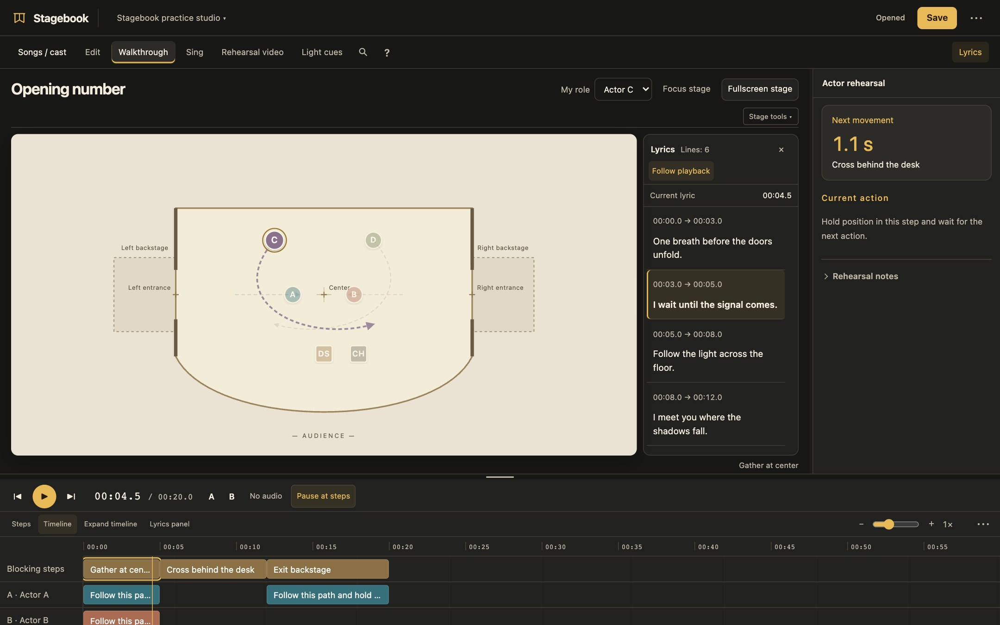
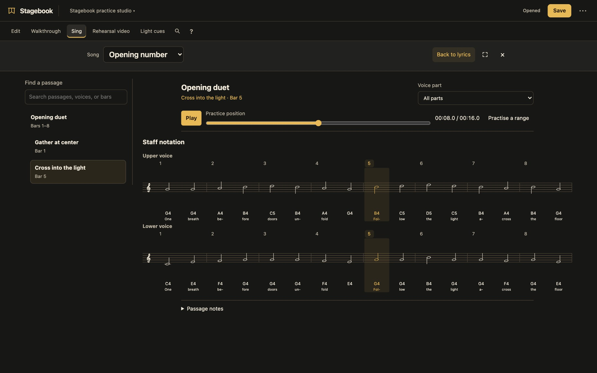
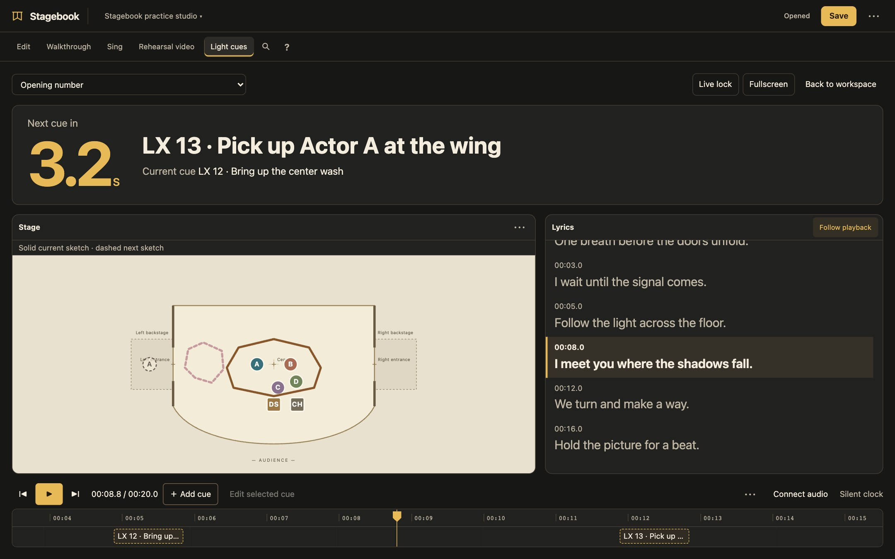
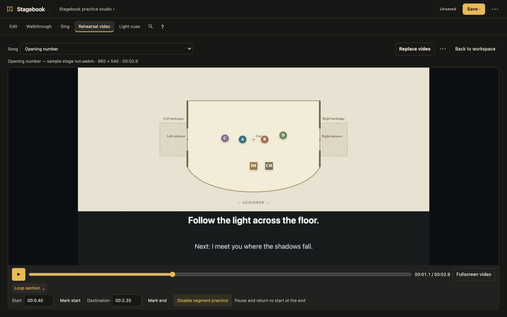
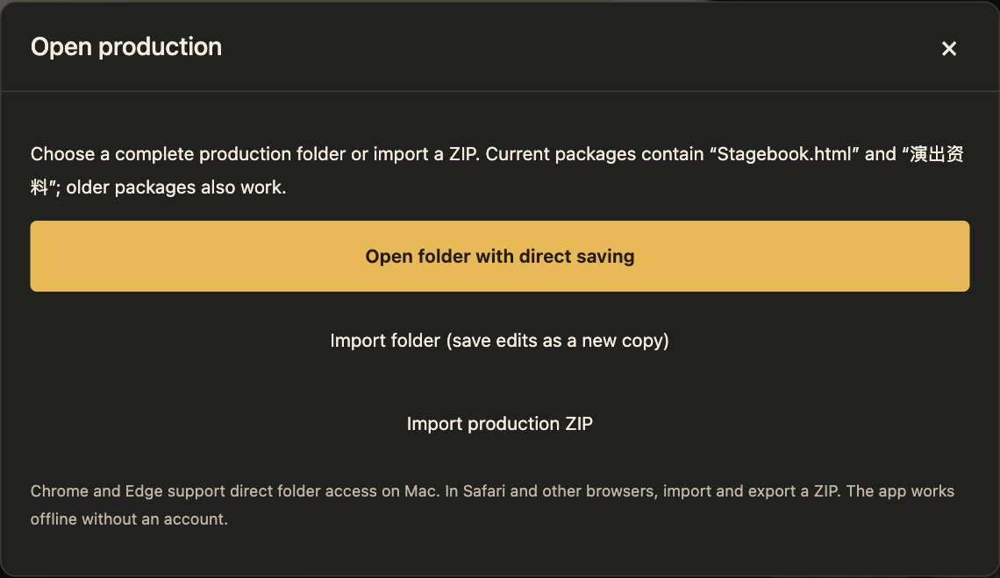
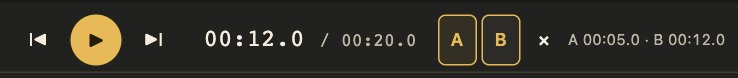
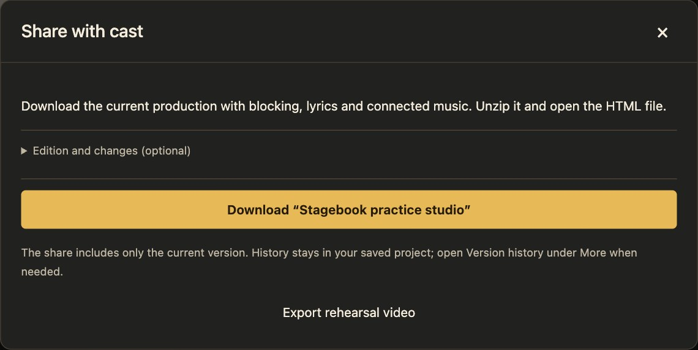
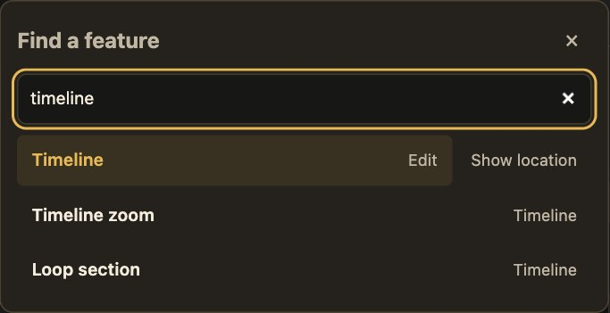

# Stagebook

Stagebook is an offline workspace for blocking and rehearsing musical theatre, plays, and student productions. Time an entrance against a lyric, give actors the same stage plan to practise from, and put the next lighting cue on a screen at the desk.

**[Download Stagebook 10.1.1](https://github.com/YiChenLu0119-prog/stagebook/releases/download/v10.1.1/Stagebook-v10.1.1-offline.zip)** · [Hamilton production](#try-the-hamilton-production) · [FAQ](#faq) · [Release notes](https://github.com/YiChenLu0119-prog/stagebook/releases/tag/v10.1.1) · [Roadmap](docs/ROADMAP.md)

## Start in three steps

1. **Open the app.** Extract the offline ZIP and open **Stagebook.html** in a desktop browser. Keep the **演出资料** folder beside it. Stagebook works offline without an account.
2. **Open a production.** Try the bundled demo or choose **⋯ → Import → Import production ZIP** for an existing production. To learn the layout in the app, choose **Quick guide → Start the tutorial**.
3. **Choose what you need to do.** Use **Edit** for blocking, **Walkthrough** to rehearse your own moves, **Sing** for lyrics and harmony, **Rehearsal video** for a recording, or **Light cues** at the lighting desk.

Choose English, Simplified Chinese, Traditional Chinese, Japanese, or Spanish under **⋯ → Interface language**. Use **Find a feature** to find a tool by name. Supported controls show short animated demos on hover or touch and hold. The demos can be turned off in **⋯ → Workflow preferences**.

## From blocking to rehearsal

### Directors and choreographers

Move the playhead to an entrance or a lyric, add a step there, then drag cast members to their destinations. Each actor has their own clip, so one performer can finish crossing before the next begins. Drag through the timeline to see the stage update as you review. When a formation is ready for a spacing pass, choose **Stage tools → Check alignment…** to preview alignment or equal spacing and keep a chosen performer fixed.

<strong>Actors · Walk through your part</strong>

Choose your role in **Walkthrough** to see your current action, the time until your next move, and any notes from the director. Use fullscreen when a group needs to see the stage together.

<strong>Singers · Find your entrance and practise harmony</strong>

In **Sing**, highlight your roles while keeping the other singers' lines visible. Jump to your next entrance, slow playback, or open a lyric’s **⋯ → My note** to leave a reminder in your browser. For songs with voice data, **Harmony practice** shows a continuous staff. Hear one part, listen to all parts together, or practise a range of connected passages. Editable voice data travels with the production.

<strong>Lighting crew · Call the next cue</strong>

Place a lighting cue at the playhead and optionally snap it to a lyric. Sketch each cue on the stage. To edit or delete a cue, select it from the list beside the timeline. Right-click its marker or press **F2** with a cue selected to open the editor. The fullscreen **Light cues** workspace shows the countdown, cue text, lyrics, and a faint preview of the next sketch.

<strong>Cast and crew · Review rehearsal video</strong>

Attach a recording to a song, scrub to the section you want, or open the player fullscreen. Mark the beginning and end of a passage. At its end, playback pauses and returns to the beginning for another pass.

## Try the Hamilton production

[Download the complete 17-song Hamilton production ZIP](https://github.com/YiChenLu0119-prog/stagebook/releases/download/v10.1.0/Hamilton-17-song-production.zip) (about 321 MB). It includes audio, timed lyrics, editable voice practice data, and blocking for **Alexander Hamilton** and **My Shot**. The opening number also includes a lighting cue and full-song rehearsal video. The library includes three saved production snapshots and a separate reference entry for the opening number.

To use the latest Stagebook version with this production, open the new **Stagebook.html** and choose **⋯ → Import → Import production ZIP**.

## FAQ

<strong>How do I open a ZIP someone sent me?</strong>

Open Stagebook and choose **⋯ → Import → Import production ZIP**. Select the ZIP itself. Save your current work first if you have another production open. When upgrading, open the new **Stagebook.html** first, then import your saved production.

<strong>Why is there no sound?</strong>

Choose the song first. A packaged MP3 connects automatically when present. If the playback bar shows **Import audio**, select an MP3 for that song. If it shows **Connect audio**, select the song's original MP3, from the extracted package if available. Once **Audio ready** appears, press Play and save the production to keep the connection. Use **Silent playback** to review blocking while the MP3 is unavailable.

<strong>How do I add, retime, or delete a movement?</strong>

1. In **Edit → Timeline**, drag the playhead to the desired time and press **N** or choose **+ Add step**. Drag an actor on the stage to set their destination.
2. Drag the middle of that actor's clip to move it in time. Drag an edge to change its timing.
3. Right-click the actor or clip and choose **Delete movement** to remove that actor's move. Use **Delete step** to remove the whole step. For an intermediate point, right-click the movement clip, choose **Edit path points**, then select the point and press Delete or Backspace. Use **⌘/Ctrl + Z** to undo.

The stage and actor tracks are shown together in the [Edit screenshot](docs/images/v10.1/blocking.jpg).

<strong>How do I loop or stop looping one section?</strong>

In **Edit** or **Walkthrough**, position the playhead at the start and click **A** in the playback bar. Move it to the end and click **B**. Click the active **B** to stop the loop and keep **A** ready. Click the active **A** to clear both markers. If the buttons are hidden, enable them in **⋯ → Workflow preferences**.

<strong>How do I practise just my singing part?</strong>

Open **Sing → Choose my roles** and select your roles. Use **Next own line** to skip to your next entrance. Open a lyric’s **⋯ (Line actions)** to choose **Loop this line** or **My note**. If the song contains voice data, open **Harmony practice** and choose the part or connected passage you want to hear. Use **My note** to mark a line or leave yourself a reminder. Personal lyric marks and notes stay in your browser.

<strong>Which file should I keep, and which should I send to the cast?</strong>

Use **Save** to keep the full library with version history. When working without a connected folder, choose **Download package** and keep that ZIP as your working copy. Use **⋯ → Share with cast** to download the current production for your team. The cast copy carries the blocking, lyrics, and connected media. History stays with your working copy by default.

<strong>Where is the tool I need?</strong>

Choose **Find a feature**, type a task such as “timeline,” and choose **Show location** on the result to highlight its control. For a guided tour, choose **Quick guide → Start the tutorial**. [See the first tutorial step](docs/images/v10.1/quick-guide.jpg).

For more on keyboard shortcuts, version history, printable rehearsal notes, and video export, see the [quick start](docs/quick-start.md). Screenshots were captured in Stagebook 10.1.0 with the interface set to English. The screenshots use a sample production. The video frame comes from Stagebook’s own stage export.

## Prepare a production with an external AI assistant

Share the [AI import guide](AI-GUIDE.md) and a saved production with your assistant. It can draft a stage from measurements, build a cast list, draft movement paths, prepare lyric timings from supplied audio, or format editable voice parts. Ask for an import-ready ZIP, then check the result in Stagebook before rehearsal. For changes to the app itself, see the [AI development guide](AI-DEVELOPMENT.md).

## What's next

Future updates will explore clearer handoffs, easier editing across screen sizes, accessibility and browser compatibility, and a possible desktop edition. Follow the [roadmap](docs/ROADMAP.md) or [open an issue](https://github.com/YiChenLu0119-prog/stagebook/issues) with the rehearsal task you were trying to complete.

## Build and license

Run `python3 build.py` and open `dist/Stagebook.html`. Run `node scripts/check.cjs` for the automated checks. See the [development notes](docs/development.md) and [data and privacy](docs/data-and-privacy.md).

Stagebook is licensed under [GPL-3.0-only](LICENSE). Imported music, lyrics, and production material retain their own permissions.
