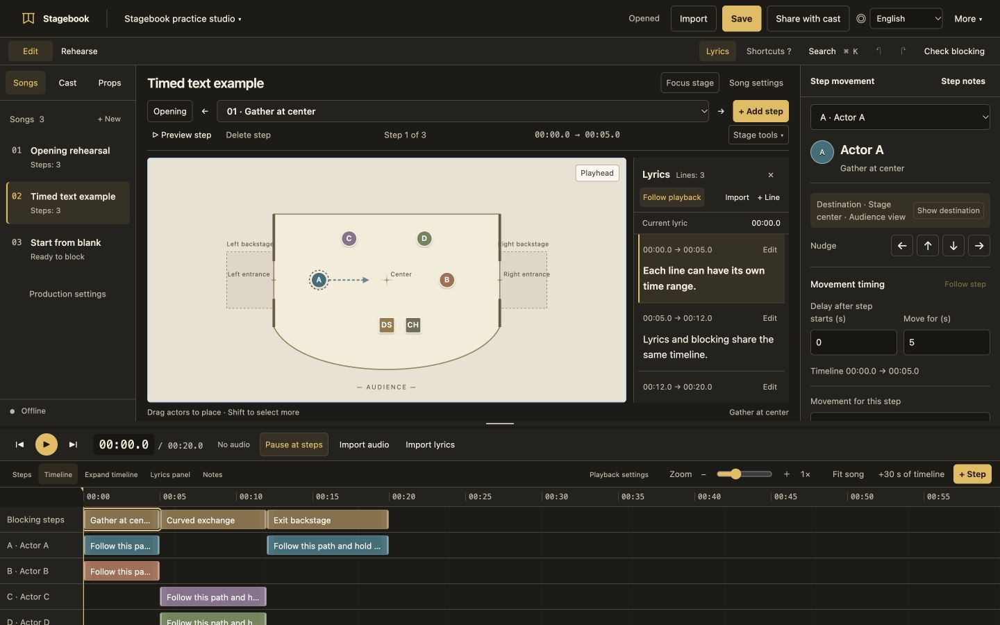
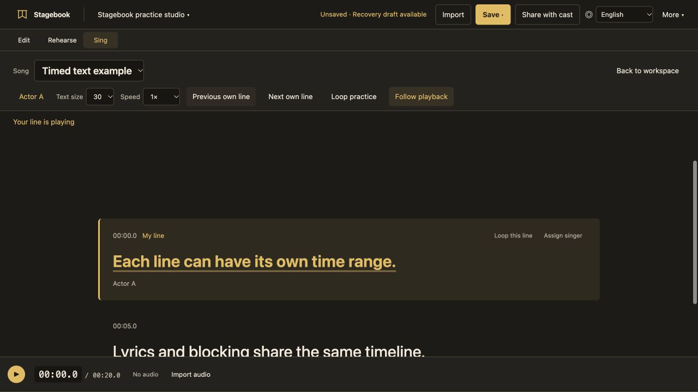

# Stagebook

An offline blocking and rehearsal workspace for musical theatre, plays and staged performances.

Put actors on a stage, draw their movement, and place it against song time and lyrics. Keep the director’s notes beside the action, then give the cast one portable production package. No account or installation is required. Music and lyrics are optional.

**Interface languages:** English · 简体中文 · 繁體中文. Switch languages in the top bar. Character names, lyrics and your production notes stay exactly as written.

[Download](https://github.com/YiChenLu0119-prog/stagebook/releases/tag/v9.4.0) · [Quick start](docs/quick-start.md) · [Roadmap](docs/ROADMAP.md) · [Changelog](CHANGELOG.md) · [Contributing](CONTRIBUTING.md)



## Singing practice



Choose **Sing** to focus the workspace on large, synchronized lyrics. Select **Choose my roles** to highlight your own parts while keeping other singers visible, including split lines and ensemble cues. Your role and text-size choices stay in this browser. They do not change the shared production.

Use **Previous own line / Next own line** to reach your entrances, **Loop this line** for one phrase, or **Loop practice** to choose a first and last line. Loops include a configurable pickup (two seconds by default). Slow playback preserves pitch in browsers that support it. Blocking pause markers are temporarily ignored in Sing mode without changing the production's settings. **Back to workspace** restores your previous working view and retains the current playhead.

Singer tags such as `[Actor A]` are read from the lyric text. Unattributed words stay neutral; the app does not infer singers from blocking. Use **Assign singer** to save an explicit attribution, or tag each part of a shared line separately. All lyric text remains visible. This highlights timed lines and attributed phrases; it does not generate word-level karaoke timing, isolate vocals or score singing.

Lyric following now centers the current line inside its own scroll area, including the first and last lines. Scroll manually to browse, then choose **Return to current line**. Long sidebar song titles stay inside their cards and gently scroll when selected or hovered. Reduced motion uses stationary, manually scrollable titles.

## Editing workspace and appearance

Version 9.3 gives the timeline the full workspace width, so more actor tracks can be edited directly. Actor delay, movement duration and absolute timing sit above the movement note. Stage instructions sit outside the canvas, and entrance labels stay easier to distinguish when panels resize.

Use **More → Appearance** to choose a palette. Hamilton is the initial default; later choices are remembered in this browser.

| Palette | Colors |
| --- | --- |
| Phantom | Ink, ivory and crimson |
| RENT | Black, white and poster red |
| Hamilton | Ink and antique gold |
| Dear Evan Hansen | Midnight and sky blue |

These are original color interpretations inspired by the musicals, without official logos or artwork. Appearance changes the tools around your production; actor colors, blocking, Undo state and shared data remain unchanged. Short color feedback and opacity reveals respect the system's reduced-motion preference. The stage, routes, handles and timeline clips stay immediate.

Medium windows keep the stage and lyrics beside each other; narrow windows use side-panel drawers. The wider timeline takes some vertical room from the stage. Use Focus stage or drag the divider when you need more stage space. Complete mobile editing is still unverified. See the [design review](DESIGN-REVIEW.md) for evidence and tradeoffs.

## Built around musical-theatre rehearsals

A musical’s blocking is tied to more than a list of destinations. One actor may cross on a lyric, another may wait two beats before following, and a third may stay still through the next entrance. Those movements need to make sense against the same song, while the stage picture, entrances and notes remain easy to check.

- **Plan a number before rehearsal.** Set the cast’s opening positions and work through a song one cue at a time. Place a step at an exact time, draw the actors’ routes and keep the relevant lyric visible beside the stage.
- **Give each performer their own timing.** A four-second step does not force everyone to move for four seconds. One actor can wait half a second, cross in two and a half seconds, and hold the destination; another movement can continue beyond the step.
- **Record changes in the room.** Adjust a destination or curve, add an intermediate point, and note focus, pace, a prop handoff or a held reaction. Editing a route or note keeps the playhead where you left it.
- **Rehearse a difficult passage.** Zoom into the timeline, return to a lyric, preview one step, or run continuously. Use the actor-focused rehearsal view to see a character’s current and upcoming instructions.
- **Help the cast review between rehearsals.** Share one package containing the blocking, notes, timed lyrics and connected audio. A cast member can extract it and open the HTML file in a desktop browser without an account.
- **Work with unreliable internet.** The editor runs locally. A saved package gives you a copy you can carry to another computer and continue editing.

The same workflow also suits spoken scenes, student theatre and other staged sequences. You can block without a soundtrack or lyrics and add those references later.

## What it makes easier

When a stage sketch, lyric sheet, audio player and rehearsal notes live in separate places, checking a change means switching between them and explaining how they relate. A written instruction such as “cross here” also leaves the route, start time and performer unclear.

Stagebook puts the stage picture, timeline, lyrics and instructions next to each other. You can point to a performer’s path and timing, change it in place, and save the same version for the cast. That reduces the work of translating a sketch into a time reference or collecting separate files for handoff.

It remains a planning aid. Paths are schematic; checks do not model body sizes, collisions, sightlines or prop handling. Confirm the blocking with people in rehearsal. The app does not listen to a song, transcribe lyrics or decide artistic blocking for you.

## Where an external AI assistant can help

Stagebook’s portable files also make it a workspace for AI-assisted staging. The editor does not contain a networked AI service: use your preferred external assistant, then import its files and review the result here.

- **Organize a whole production.** Turn a script breakdown into scenes or songs, cast and prop lists, and rehearsal notes. Keep one shared stage while building the show a number at a time.
- **Draw the stage model.** Give an assistant a sketch and measured dimensions; ask it to prepare the stage boundary, walls, backstage areas and entrances. Import the model, then visually check its proportions and adjust it. A photo alone is not a reliable measurement.
- **Prepare song and lyric timing.** With the actual audio and supplied text, an assistant with transcription/alignment tools can prepare timed lyrics and propose cue times. Review uncertain timestamps against playback. Without the audio, it should label rough timing rather than invent exact synchronization.
- **Draft and revise blocking.** Ask for an initial arrangement, routes through entrances, staggered movements or performer-specific notes. Then make artistic and practical changes on the stage and timeline. An AI draft still needs rehearsal checks.
- **Apply consistent changes across a show.** Rename a role, revise recurring notes or adjust requested time ranges while preserving IDs, unrelated blocking and audio references.

Give the assistant the saved production package and [AI-GUIDE.md](AI-GUIDE.md). The guide specifies the accepted manifest, stage, song, movement and lyric formats, plus a portable validator. Ask it to return an actual import-ready ZIP, not just a pasted song JSON fragment. Open it with **Import → Import production ZIP**, or use **Reload folder** when the assistant edited a connected project folder. Keep the previous package so you can compare versions.

## Get started

1. Download **[Stagebook-v9.3.0-offline.zip](https://github.com/YiChenLu0119-prog/stagebook/releases/download/v9.3.0/Stagebook-v9.3.0-offline.zip)** from [Releases](https://github.com/YiChenLu0119-prog/stagebook/releases). Choose the named offline asset; source archives are for development.
2. Extract the ZIP and open **Stagebook.html** in a desktop browser. Older packages may call this file **走台本.html**.
3. Explore the generic sample, or open the production menu at the top left and choose **New production**. Add your cast and drag their opening positions into place.
4. Click the playback clock or timeline to choose a start time, then choose **Add step** or press `N`. Drag an actor to a destination and set their movement timing and note.
5. Use **Save → Download package**. The saved library remembers the selected production and song. Use **Import** to reopen it; **Share with cast** packages it for others.

A **step** is a timed blocking cue for the cast. A **movement** is one actor’s path, delay and duration associated with that step. Movements can have different timings and can continue beyond their step.

## Keep rehearsal changes traceable

Use **More → Version history** when you want to keep a milestone. Add an optional name and description; the date and time are recorded automatically. View or export an older version, or restore it with a backup of the displaced work and Undo available. Connected music is retained with the snapshot; missing music is identified. Ordinary Save does not create a history entry or ask for a version name.

**Save → Download package** keeps the full production history and historical audio. **Share with cast** includes the current production without its history by default. Its collapsed optional settings let you name the edition and write a brief change summary. The exported file carries that identity; subsequent edits are marked as changes since that edition. Offline files do not know which edition everyone else is using, and changes from different files are not merged automatically.

## Turn existing notes into rehearsal handoffs

In **Notes**, add an existing note to **Rehearsal notes**, or write one at the current step. One shared note keeps one editable body, even when it concerns several performers. Mark it **For discussion**, **Decided** or manually **Checked in rehearsal**. Changes to the related song, stage or note flag an earlier check for review. Linked notes follow their step's timing; missing links are identified.

Filter by role and time, select the notes to include, and preview a printable HTML notes sheet with the edition, audience side and named entrances. Whole-step notes also reach performers holding a position. A notes sheet is a selected handoff, not a full movement score or an access-control system. Manual status labels are not delivery receipts or proof that an actor understands the change.

## Updating from an earlier release

Save your current work first. Extract the new offline download and open its **Stagebook.html**, then import your saved production ZIP. **Import replaces production data; it does not upgrade the program in an already-open older tab.**

Version 9.2 fixes MP3s losing their audio media type during ZIP import and normalizes untyped folder/cache files before playback. The imported audio is retained for recovery drafts. Existing version-1 production packages remain supported, including packages with no audio or lyrics. Browser drafts still do not replace a saved file.

## Editing without fighting the timeline

Add steps at the playhead without shifting existing start times or switching away from your current view. A blank timeline has a one-minute editing range. Enter a later time directly or extend the visible range with **+30 s of timeline**; extra editing space does not add silent time to playback.

Pinch with two fingers over the timeline to zoom around the pointer, or use the slider and buttons. A two-finger horizontal swipe browses the timeline. `⌘ / Ctrl + wheel` also zooms. Drag an actor’s clip to move it in time, or its edges to change its delay or duration, leaving other performers’ timings alone.

Right-click a step, performer, path or point for relevant commands. Select an intermediate path point and press Delete, or use its visible delete button. Undo and Redo keep the path editor open. Walls and backstage areas have draggable points and outlines; marks can be dragged into place. Coordinate data stays under Advanced settings. New-production, song and actor forms work inside the app. Deleting or replacing work uses an in-app confirmation with a clear Cancel choice.

## Save, languages and privacy

The app remembers your interface language in this browser. Exported HTML carries a default language; a viewer’s saved preference takes priority. Switching languages preserves the playhead, selection, view, zoom and production text.

Save a package for a durable copy. Browser drafts help with recovery. Direct folder saving depends on browser support; ZIP import/export is available otherwise. Desktop mouse and keyboard use is the current focus; complete mobile and touch editing is not yet verified.

The app has no built-in cloud sync, analytics, login or networked AI. Each song can use one MP3. Prepare lyrics and timestamps externally if needed; plain JSON files can be edited by an assistant following [AI-GUIDE.md](AI-GUIDE.md).

Public downloads contain generic examples only, without commercial soundtracks, full song lyrics or private productions. Exported packages and HTML may contain your connected audio and production data, so review their contents before sharing. See [data and privacy](docs/data-and-privacy.md).

## Ongoing development

Stagebook will continue to evolve through real rehearsals and hands-on feedback. This preview adds a wider editing workspace and four appearance palettes while retaining traceable versions and rehearsal handoffs; future work will explore editing comfort, browser and file compatibility, accessibility, translation quality and useful public examples.

A desktop edition is also being evaluated, reusing the editor while adding native file opening, saving and installation. It is an exploration, with no release date or supported-platform promise yet. See the [roadmap](docs/ROADMAP.md) and [desktop edition plan](docs/desktop-app-plan.md).

Future exploration also includes named rehearsal passages and lightweight call planning, after real teams confirm they reduce rather than duplicate work. Scheduling, performer/track mapping and cloud collaboration are not included in this release.

Open an Issue with a specific rehearsal task and the point where the workflow got in your way. Watch Releases to follow completed updates. Priorities may change with feedback.

## Build and contribute

```sh
python3 build.py
node scripts/check.cjs
```

Open `dist/Stagebook.html` after building. No third-party build packages are required for the offline web edition. See [development notes](docs/development.md).

## License

Application source is licensed under **GNU General Public License v3.0 only**, SPDX identifier `GPL-3.0-only`. See [LICENSE](LICENSE). Imported music, lyrics, scripts and production material have their own permissions and sharing requirements.
